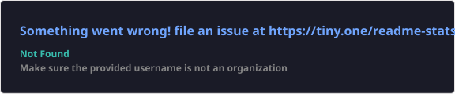

<h1> Hey! Nice to meet you!</h1>

<p>I'm Junyan (Toshi) Li, a software engineer with a passion for learning and creating. I enjoy exploring new technologies and building projects that solve real-world problems.</p>

### A passionate software engineer

- 🔭 I'm currently working on **a MAA Framework based Nikke autoscript**

- 🌱 I'm currently learning **Golang & Neovim**

- 📫 How to reach me **toshi.li@icloud.com**

**Things I code with**
<p>
  
  
  
  
  
  
  
  
  
  
  
  
  
</p>


🔥 **Streak**
<p>
    
</p>

<!--START_SECTION:waka-->


**I'm a Night 🦉** 

```text
🌞 Morning                400 commits         ███░░░░░░░░░░░░░░░░░░░░░░   11.56 % 
🌆 Daytime                965 commits         ███████░░░░░░░░░░░░░░░░░░   27.89 % 
🌃 Evening                1267 commits        █████████░░░░░░░░░░░░░░░░   36.62 % 
🌙 Night                  828 commits         ██████░░░░░░░░░░░░░░░░░░░   23.93 % 
```
📅 **I'm Most Productive on Sunday** 

```text
Monday                   356 commits         ███░░░░░░░░░░░░░░░░░░░░░░   10.29 % 
Tuesday                  567 commits         ████░░░░░░░░░░░░░░░░░░░░░   16.39 % 
Wednesday                535 commits         ████░░░░░░░░░░░░░░░░░░░░░   15.46 % 
Thursday                 475 commits         ███░░░░░░░░░░░░░░░░░░░░░░   13.73 % 
Friday                   459 commits         ███░░░░░░░░░░░░░░░░░░░░░░   13.27 % 
Saturday                 483 commits         ███░░░░░░░░░░░░░░░░░░░░░░   13.96 % 
Sunday                   585 commits         ████░░░░░░░░░░░░░░░░░░░░░   16.91 % 
```


📊 **This Week I Spent My Time On** 

```text
💬 Programming Languages: 
Other                    22 hrs 56 mins      ██████████░░░░░░░░░░░░░░░   38.63 % 
Markdown                 11 hrs 31 mins      █████░░░░░░░░░░░░░░░░░░░░   19.39 % 
Go                       10 hrs 9 mins       ████░░░░░░░░░░░░░░░░░░░░░   17.11 % 
JavaScript               5 hrs 5 mins        ██░░░░░░░░░░░░░░░░░░░░░░░   08.56 % 
Python                   3 hrs 22 mins       █░░░░░░░░░░░░░░░░░░░░░░░░   05.68 % 

🔥 Editors: 
Codex Vscode             56 hrs 51 mins      ████████████████████████░   95.70 % 
Codex Exec               2 hrs 19 mins       █░░░░░░░░░░░░░░░░░░░░░░░░   03.90 % 
Codex CLI                14 mins             ░░░░░░░░░░░░░░░░░░░░░░░░░   00.40 % 

🐱‍💻 Projects: 
prototype-evals          28 hrs 50 mins      ████████████░░░░░░░░░░░░░   48.54 % 
prototype-plugins        23 hrs              ██████████░░░░░░░░░░░░░░░   38.74 % 
doop                     4 hrs 13 mins       ██░░░░░░░░░░░░░░░░░░░░░░░   07.10 % 
flux-prototype-evolving  2 hrs 3 mins        █░░░░░░░░░░░░░░░░░░░░░░░░   03.45 % 
https-bits-bytedance-net-38 mins             ░░░░░░░░░░░░░░░░░░░░░░░░░   01.09 % 

💻 Operating System: 
Mac                      59 hrs 24 mins      █████████████████████████   100.00 % 
```

🤖 **AI Coding This Week** 

```text
⏱ AI Coding Time: 59 hrs 24 mins (100.0%)

✍️ 14,537 lines written by AI, 0 lines written by hand (100.0% AI-written)

🔤 57,462,156 Input Tokens, 9,025,040 Output Tokens

💵 $1102.75 Estimated AI Cost This Week

🧠 553 AI Sessions, 765 AI Prompts

GPT                      14,667 lines        █████████████████████████   100.00 % 
Codex-Vscode             0 lines             ░░░░░░░░░░░░░░░░░░░░░░░░░   00.00 % 

🔎 AI Coding Insights:
🤖 AI-Driven — 100.0% of written lines came from AI
📄 Detailed Prompter — average 767 characters per prompt
🎯 One-Shot Prompter — average 1 prompts per session
🚀 High AI Trust — 0.0% of changed lines were hand-edited
```


 Last Updated on 29/10/2026 13:37:52 UTC
<!--END_SECTION:waka-->

🚀 **Top languages**
<p>
    
</p>

<details>
<summary><b>Stats</b></summary>
    <p>
        
    </p>
</details>
